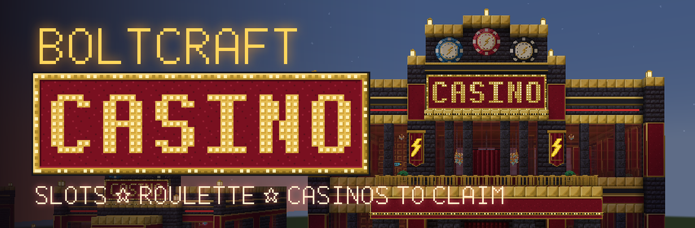
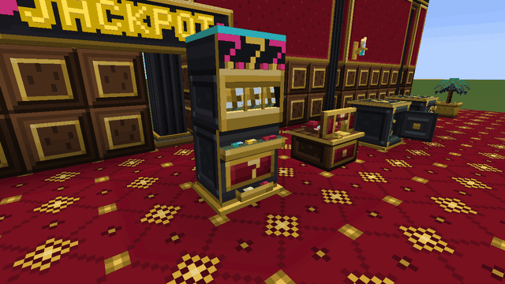
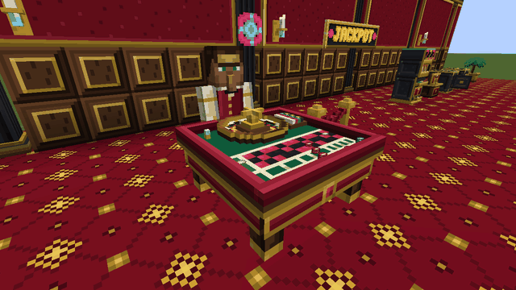
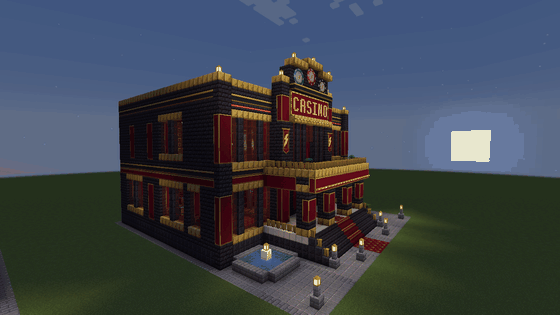
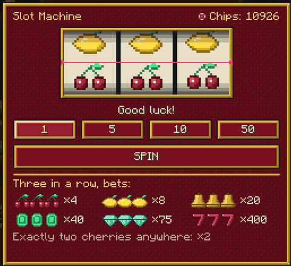
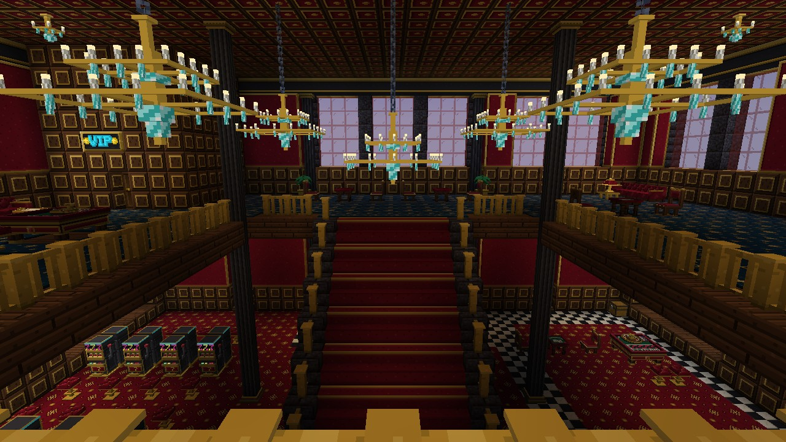
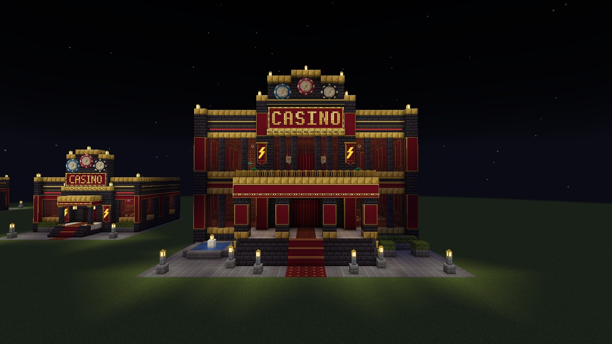
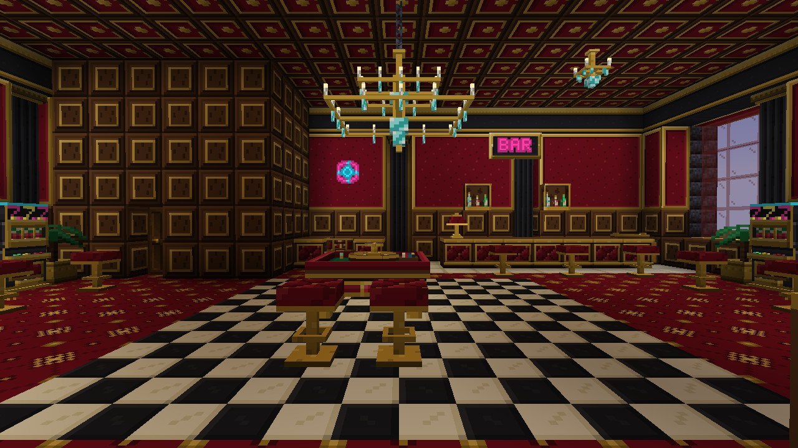

<p align="center">
  
</p>

<p align="center">
  <a href="https://github.com/Mbolt1337/boltcraft-casino/actions/workflows/build.yml"></a>
  
  
  
  <a href="LICENSE"></a>
  <a href="LICENSE-ASSETS.md"></a>
</p>

<p align="center">
  <b>A casino you build and run in Minecraft.</b> Slot machines, multiplayer roulette with a villager croupier,
  vaults, cashiers and two abandoned casinos waiting to be found.<br>
  Played with in-game resources and chips only. <b>Never real money.</b>
</p>

<p align="center">
  <a href="README.ru.md">Читать по-русски</a>
</p>

<table>
  <tr>
    <td width="50%"></td>
    <td width="50%"></td>
  </tr>
  <tr>
    <td align="center">Triple seven. The machine pours out the jackpot.</td>
    <td align="center">The croupier throws the ball and calls the number.</td>
  </tr>
</table>

> **Status: early preview.** Everything below is in the game and tested, but the first release is still going
> through its last checks (survival from scratch, a dedicated server, playing with friends). Star or watch the
> repository to hear when the first build is out.

## What's inside

**Run your own casino.** Place a vault and fill it with resources: they back every win. Tie a cashier and the
games to it with the manager's key. Players change iron, gold, emeralds or diamonds into chips at the cashier, play,
and change their chips back. The vault keeps a ledger of the last 200 operations and refuses any bet it could not pay
out.

**Slot machine.** Three real reels, six symbols and a lever. The server picks the outcome before the reels move, and
everyone standing nearby sees them stop on it. A win pours chips out of the tray; triple seven is a fountain of chips,
sparks and chasing lights. Return to player is 93.39%, a jackpot comes once in 32,768 spins.

**Roulette with a croupier.** A European single-zero wheel for any number of players at once. A villager in a
burgundy waistcoat takes his place behind the table, greets you, calls *"Place your bets!"*, *"No more bets!"* and
the number, and gestures as he throws the ball. Every bet is stacked on the felt where everyone can see it.

**Abandoned casinos in the world.** A neon lounge and a two-storey grand hall generate in plains, deserts, savannas
and badlands. Claim the empty vault with your key, tie the games to it, and the casino is yours. The slot machines
and tables are part of the building: they work where they stand, but you can't break them off and carry them away.

<p align="center">
  
</p>

**64 decor blocks.** Neon letters in 66 characters and seven colours, neon tubes that join on the wall, signs and
boards, chasing lights, carpets, marble and checkered tiles, gilded panels, coffered ceilings, chandeliers, a bar with
bottle shelves, sofas and chairs you can sit on, CASINO marquees, giant chips. Food and drinks for the bar, and a
serving tray that holds four portions.

**A guide book** every player gets once, with the server's real exchange rates and payout table; **13 achievements**;
everything in English and Russian.

<table>
  <tr>
    <td width="50%"></td>
    <td width="50%"></td>
  </tr>
  <tr>
    <td width="50%"></td>
    <td width="50%"></td>
  </tr>
</table>

More pictures are in the [gallery](docs/GALLERY.md).

## Made by one person and AI agents

BoltCraft Casino was built by Maxim with AI coding agents, mostly [Claude Code](https://claude.com/claude-code), with
Codex on some parts. The agents wrote the code, the tests and the art; Maxim set the design, reviewed every model,
screen and building in the game and approved or sent it back. [CREDITS.md](CREDITS.md) says who made what.

A few things here might interest other mod makers:

- **Pixel art as text.** No image generator made any asset. Every texture is a grid of palette letters in
  [`art/textures/`](art/textures), drawn pixel by pixel and built into PNGs by a small script. Changing a pixel is a
  one-character diff.
- **Buildings as code.** Both casinos are plans in [`art/structures/concept_casinos.py`](art/structures/concept_casinos.py),
  written room by room. A preview client builds them, photographs them and saves the templates worldgen uses.
- **Tested in a real server.** 57 unit tests, including the slot machine's exact return over all 32,768 outcomes and a
  2,000,000-spin simulation, and 53 GameTests that walk a villager from the door to the cashier, the bar and up the
  stairs of each building in all four rotations, and sit a player on every seat.
- **Tested in a real client.** Scripted clients build a showroom, play the games, take the screenshots on this page,
  and check two players over the network.

## Install

You need Minecraft **1.21.1**, [NeoForge](https://neoforged.net) **21.1.264** or newer, and
[GeckoLib](https://modrinth.com/mod/geckolib) **4.9.3** or newer. Put both jars in `mods/` on the client and on the
server. Download the mod from [Releases](https://github.com/Mbolt1337/boltcraft-casino/releases) once the first
build is out.

## Open a casino in survival

1. Place a vault: it is yours. A found casino's vault belongs to no one until you click it with the manager's key.
2. Click the vault with the key, then click the cashier and the games: they are now tied to that vault.
3. Open the vault and put in resources. They cover the winnings.
4. Players exchange resources for chips at the cashier and play. By default 10 diamonds buy 100 chips, and 100 chips
   buy them back.

Chips are items worth 1, 10, 100 and 1,000. They can't be crafted, only bought at a cashier.

## For server owners and modpack makers

- Exchange rates, bets, the payout table, roulette limits and building generation are in
  `boltcraft_casino-server.toml`, synced to clients. The log prints the slot machine's resulting return.
- Recipes, loot, tags, biomes and building frequency are ordinary data: replace them with a datapack.
- Models, textures, sounds and all texts can be replaced with a resource pack.
- The mod makes no network connections of its own and collects no telemetry.

## Build from source

```bash
./gradlew build              # the jar in build/libs and the unit tests
./gradlew runGameTestServer  # the GameTests inside a real Minecraft server
./gradlew runData            # block states, models, recipes, loot, tags, translations
./gradlew runClient
```

Java 21. Gradle downloads everything else.

## Roadmap

- [x] Vault, cashier, chips, manager's key, block protection
- [x] Slot machine with reels, animations and payout table
- [x] Multiplayer roulette with a croupier
- [x] Decor, furniture you can sit on, food and the serving tray
- [x] Two abandoned casinos in world generation
- [ ] First release: survival from scratch, dedicated server, playing with friends
- [ ] Release on CurseForge and Russian mod sites

Found a bug or have an idea? [Open an issue](https://github.com/Mbolt1337/boltcraft-casino/issues).

## License

The code is under the [MIT License](LICENSE). The textures, models, sounds and building templates are **not**: they
are all rights reserved, with permission to play, stream and include the unmodified mod in modpacks. See
[LICENSE-ASSETS.md](LICENSE-ASSETS.md).

BoltCraft Casino is not an official Minecraft product and is not approved by or associated with Mojang or Microsoft.

<p align="center">If you like it, a ⭐ helps the project more than you'd think.</p>
