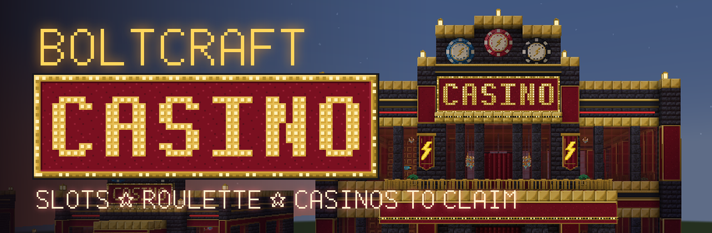
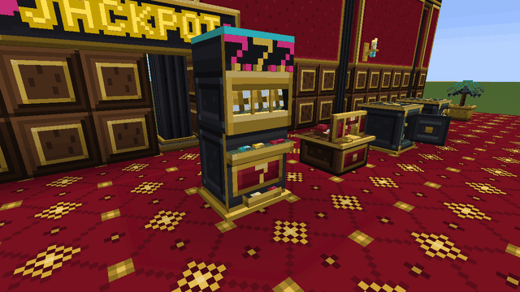
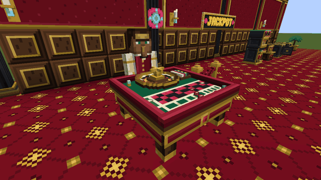
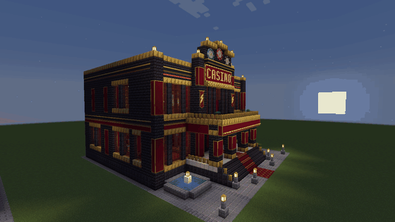
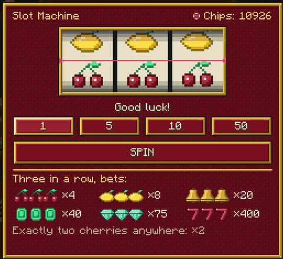
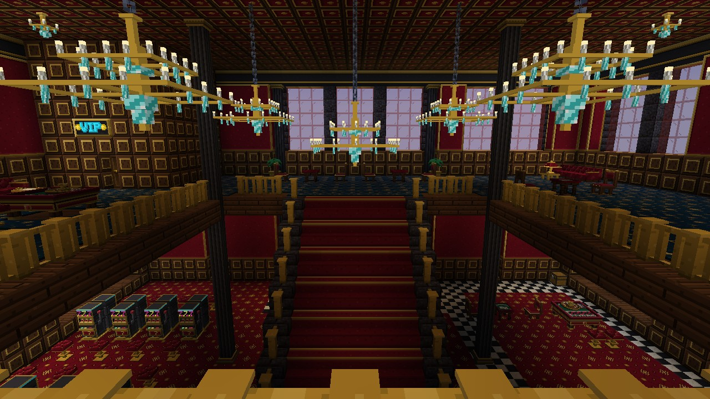
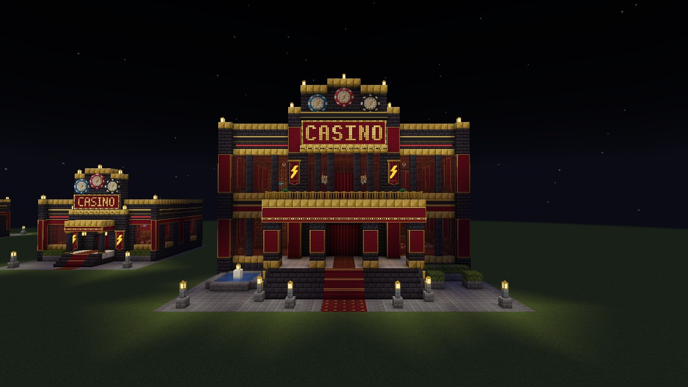
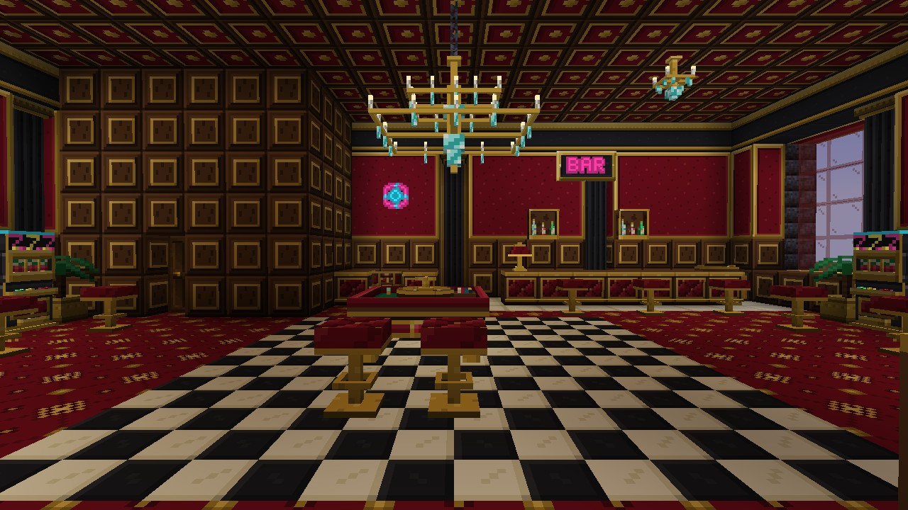

<p align="center">
  
</p>

<p align="center">
  <a href="https://github.com/Mbolt1337/boltcraft-casino/actions/workflows/build.yml"></a>
  
  
  
  <a href="LICENSE"></a>
  <a href="LICENSE-ASSETS.md"></a>
</p>

<p align="center">
  <b>Казино, которое ты строишь и держишь сам в Minecraft.</b> Игровые автоматы, рулетка на несколько игроков с
  жителем-крупье, сейфы, кассы и два заброшенных казино, которые можно найти в мире.<br>
  Играют на игровые ресурсы и фишки. <b>Никаких реальных денег.</b>
</p>

<p align="center">
  <a href="README.md">Read in English</a>
</p>

<table>
  <tr>
    <td width="50%"></td>
    <td width="50%"></td>
  </tr>
  <tr>
    <td align="center">Три семёрки. Автомат высыпает джекпот.</td>
    <td align="center">Крупье бросает шарик и объявляет число.</td>
  </tr>
</table>

> **Статус: ранний показ.** Всё описанное ниже уже есть в игре и проверено, но первый релиз проходит последние
> проверки: выживание с нуля, выделенный сервер, игра с друзьями. Поставь звезду или подпишись на репозиторий,
> чтобы узнать о первой сборке.

## Что внутри

**Своё казино.** Поставь сейф и наполни его ресурсами: они обеспечивают каждый выигрыш. Привяжи к нему кассу и игры
ключом управляющего. Игроки меняют в кассе железо, золото, изумруды или алмазы на фишки, играют и меняют фишки
обратно. Сейф ведёт журнал последних 200 операций и не примет ставку, которую не сможет выплатить.

**Игровой автомат.** Три настоящих барабана, шесть символов и рычаг. Сервер выбирает исход до того, как барабаны
тронутся, и все, кто стоит рядом, видят, как они останавливаются ровно на нём. Выигрыш сыплется фишками из лотка,
три семёрки — фонтан фишек, искр и бегущих огней. Возврат игроку 93,39%, джекпот — раз в 32 768 прокруток.

**Рулетка с крупье.** Европейское колесо с одним зеро, сколько угодно игроков одновременно. Житель в бордовом жилете
встаёт за стол, здоровается, объявляет «Делайте ваши ставки!», «Ставок больше нет!» и выпавшее число и жестом
запускает шарик. Все ставки лежат стопками на сукне на виду у всех.

**Заброшенные казино в мире.** Неоновый лаунж и двухэтажный большой зал появляются на равнинах, в пустынях, саваннах
и пустошах. Займи пустой сейф ключом, привяжи к нему игры, и казино твоё. Автоматы и столы — часть здания: они
работают на месте, но выломать и унести их нельзя.

<p align="center">
  
</p>

**64 блока декора.** Неоновые буквы — 66 знаков и семь цветов, неоновые трубки, которые соединяются на стене,
вывески и панно, бегущие огни, ковры, мраморная и шахматная плитка, панели в позолоте, кессонные потолки, люстры,
бар с полками бутылок, диваны и стулья, на которых можно сидеть, вывески CASINO, большие фишки. Еда и напитки для
бара и поднос на четыре порции.

**Книга-путеводитель**, которую каждый игрок получает один раз, с настоящими курсами и таблицей выплат сервера;
**13 достижений**; всё на русском и английском.

<table>
  <tr>
    <td width="50%"></td>
    <td width="50%"></td>
  </tr>
  <tr>
    <td width="50%"></td>
    <td width="50%"></td>
  </tr>
</table>

Больше кадров — в [галерее](docs/GALLERY.md).

## Один человек и ИИ-агенты

BoltCraft Casino сделал Максим вместе с ИИ-агентами, в основном [Claude Code](https://claude.com/claude-code), часть —
Codex. Агенты писали код, тесты и арт; Максим задавал дизайн, проверял каждую модель, экран и здание в игре и
утверждал или отправлял на переделку. Кто что сделал — в [CREDITS.md](CREDITS.md).

Что может пригодиться другим авторам модов:

- **Пиксель-арт текстом.** Ни один ассет не сделан генератором картинок. Каждая текстура — сетка букв палитры в
  [`art/textures/`](art/textures), нарисованная по пикселю; маленький скрипт собирает из неё PNG. Поменять пиксель —
  поменять один символ.
- **Здания кодом.** Оба казино — планы в
  [`art/structures/concept_casinos.py`](art/structures/concept_casinos.py), комната за комнатой. Проверочный клиент
  строит их, фотографирует и сохраняет шаблоны для генерации мира.
- **Проверки на настоящем сервере.** 57 unit-тестов, в том числе точный возврат автомата по всем 32 768 исходам и
  симуляция 2 000 000 прокруток, и 53 GameTest: житель проходит от входа к кассе, бару и по лестнице каждого здания
  во всех четырёх поворотах, игрок садится на каждое сиденье.
- **Проверки в настоящем клиенте.** Скриптовые клиенты строят выставочный зал, играют, снимают кадры для этой
  страницы и проверяют двух игроков по сети.

## Установка

Нужны Minecraft **1.21.1**, [NeoForge](https://neoforged.net) **21.1.264** или новее и
[GeckoLib](https://modrinth.com/mod/geckolib) **4.9.3** или новее. Положи оба jar в `mods/` и на клиенте, и на
сервере. Мод появится в [Releases](https://github.com/Mbolt1337/boltcraft-casino/releases), когда выйдет первая
сборка.

## Как открыть казино в выживании

1. Поставь сейф: он твой. Сейф найденного казино ничей, пока ты не кликнешь по нему ключом управляющего.
2. Кликни ключом по сейфу, потом по кассе и играм: теперь они привязаны к этому сейфу.
3. Открой сейф и положи ресурсы. Они покрывают выигрыши.
4. Игроки меняют ресурсы на фишки в кассе и играют. По умолчанию 10 алмазов — это 100 фишек, и 100 фишек
   меняются обратно на 10 алмазов.

Фишки — предметы номиналом 1, 10, 100 и 1000. Их нельзя скрафтить, только получить в кассе.

## Для серверов и сборок

- Курсы, ставки, таблица выплат, лимиты рулетки и генерация зданий — в `boltcraft_casino-server.toml`, он
  синхронизируется с клиентами. В лог пишется итоговый возврат автомата.
- Рецепты, лут, теги, биомы и частота зданий — обычные данные, их заменяет датапак.
- Модели, текстуры, звуки и все тексты заменяются ресурспаком.
- Мод сам никуда не ходит в сеть и не собирает телеметрию.

## Сборка из исходников

```bash
./gradlew build              # jar в build/libs и unit-тесты
./gradlew runGameTestServer  # GameTest на настоящем сервере Minecraft
./gradlew runData            # blockstates, модели, рецепты, лут, теги, переводы
./gradlew runClient
```

Нужна Java 21, остальное Gradle скачает сам.

## Планы

- [x] Сейф, касса, фишки, ключ управляющего, защита блоков
- [x] Игровой автомат с барабанами, анимациями и таблицей выплат
- [x] Рулетка на несколько игроков с крупье
- [x] Декор, мебель, на которой можно сидеть, еда и поднос
- [x] Два заброшенных казино в генерации мира
- [ ] Первый релиз: выживание с нуля, выделенный сервер, игра с друзьями
- [ ] Публикация на CurseForge и русских сайтах модов

Нашёл ошибку или есть идея? [Создай issue](https://github.com/Mbolt1337/boltcraft-casino/issues).

## Лицензия

Код — под [MIT](LICENSE). Текстуры, модели, звуки и шаблоны зданий — **нет**: все права защищены, но играть,
стримить и включать неизменённый мод в сборки можно. Подробно — в [LICENSE-ASSETS.md](LICENSE-ASSETS.md).

BoltCraft Casino — не официальный продукт Minecraft, не одобрен Mojang или Microsoft и не связан с ними.

<p align="center">Если нравится, поставь ⭐ — это правда очень помогает проекту.</p>
