# Gallery

Real screenshots of the game: no shaders, nothing painted over. [Back to the README](../README.md)

## The casinos

| | |
|---|---|
| 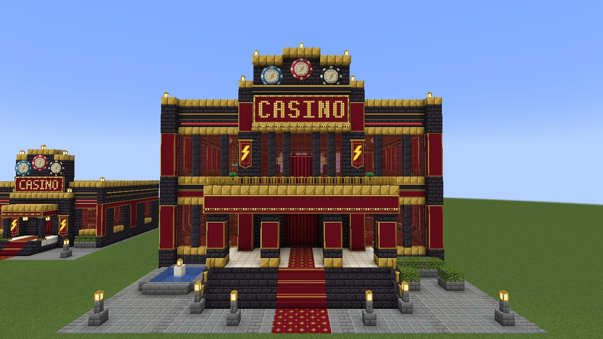 | 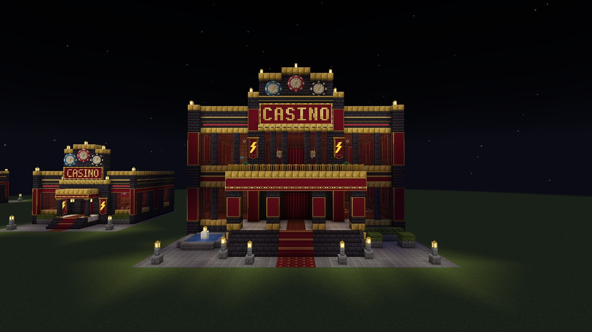 |
| The grand hall: a tower with the CASINO marquee and a crest of giant chips, a canopy with a terrace on top. | The same at night. The signs, lanterns and windows light the forecourt. |
| 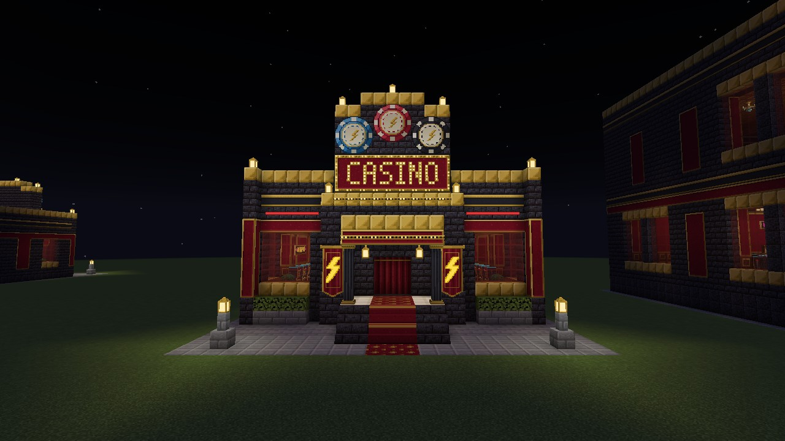 | 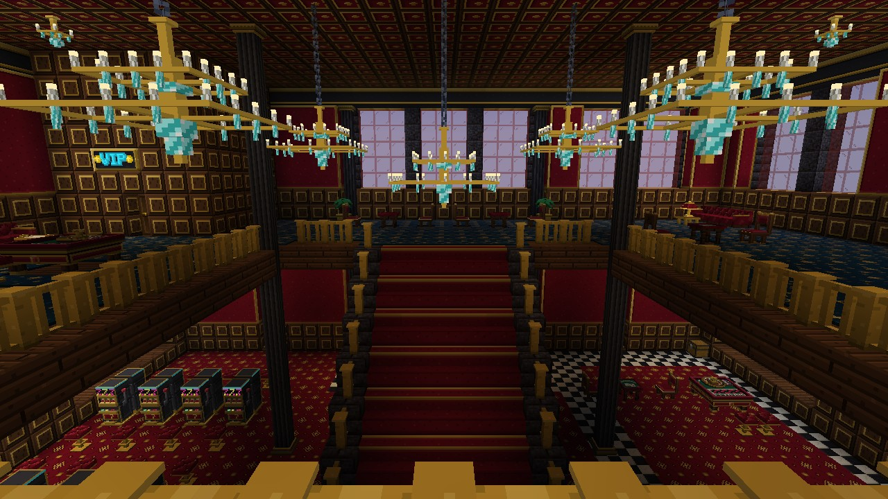 |
| The neon lounge, the smaller casino. | The atrium of the grand hall from the front gallery: the grand staircase, five chandeliers, slots and roulette below. |
| 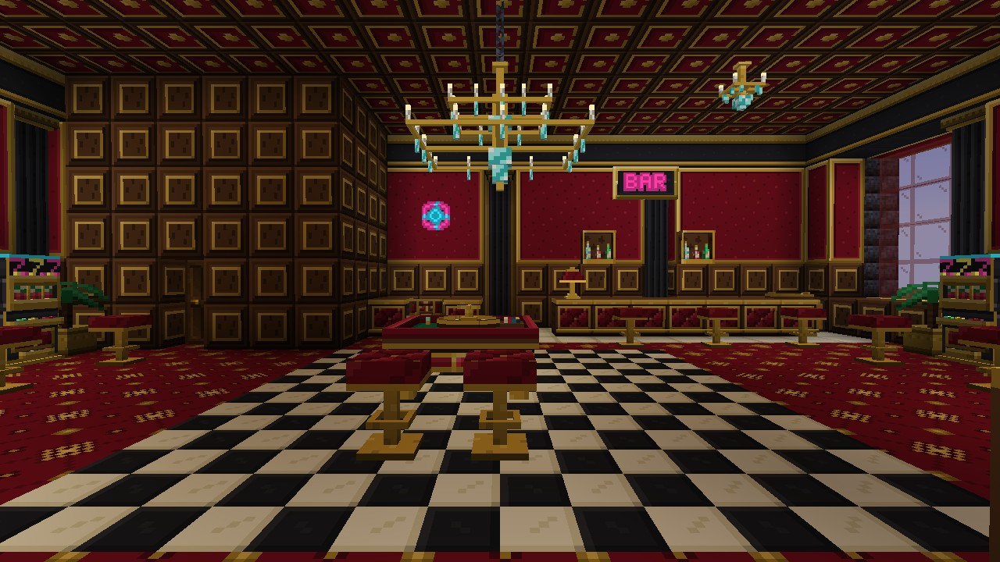 | 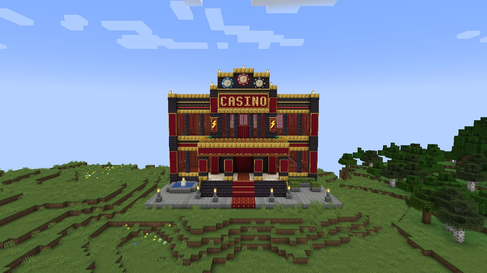 |
| Inside the lounge: roulette under the chandelier, slot machines along the walls, the bar at the back. | A grand hall as world generation placed it. |
| 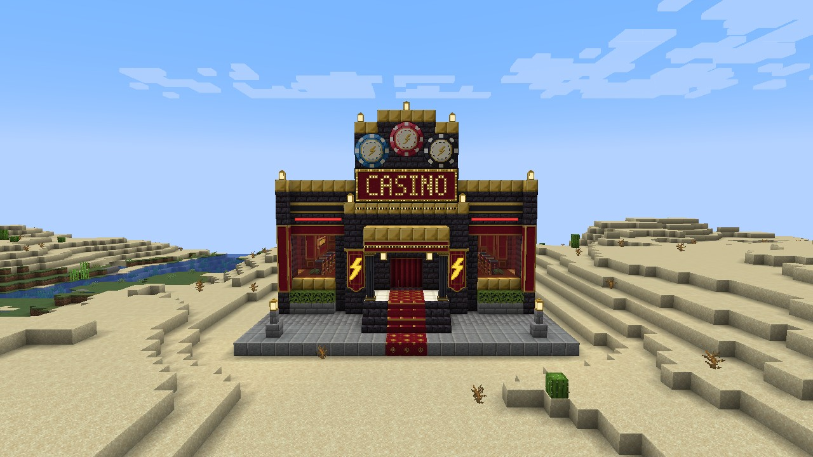 | |
| A lounge found in a desert. | |

## The games

| | |
|---|---|
| 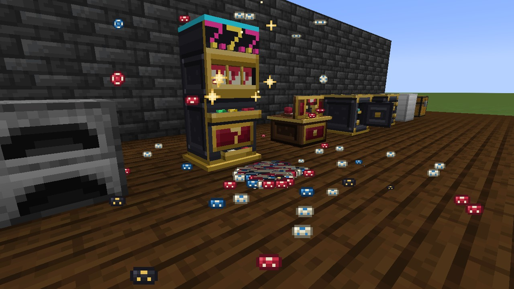 | 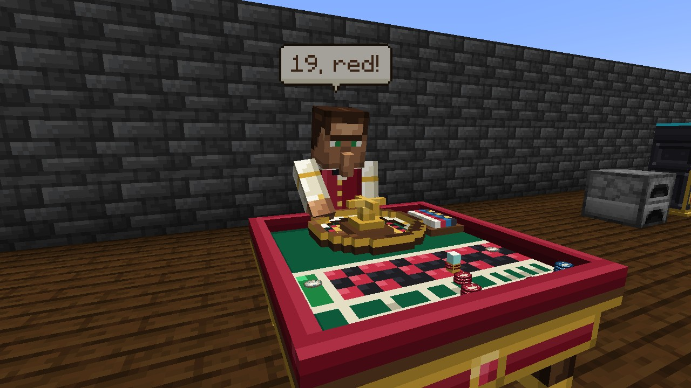 |
| After a jackpot: the chips the machine poured out. | The croupier calls the number. |
| 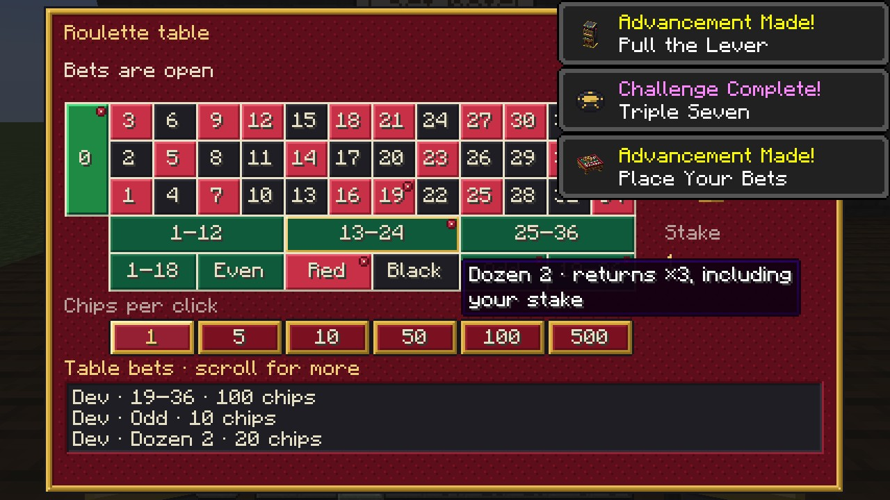 | 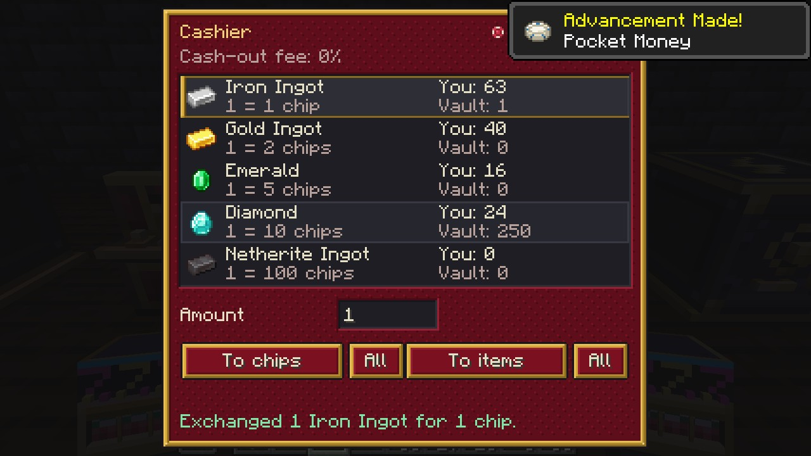 |
| Placing bets at the roulette table. | Changing resources for chips at the cashier. |
| 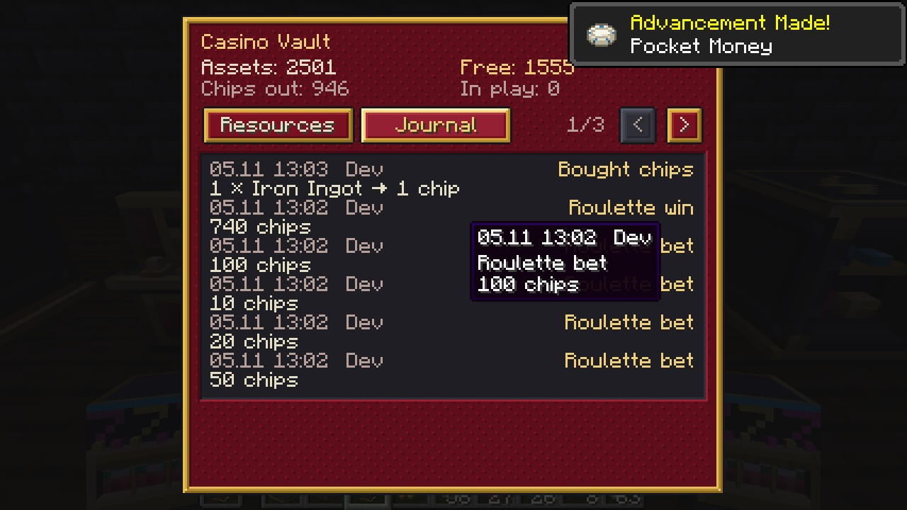 | 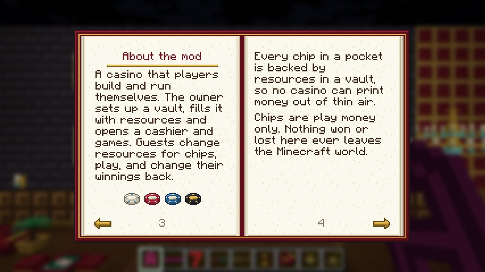 |
| The vault's journal of every operation. | The guide book every player gets. |

## Decor

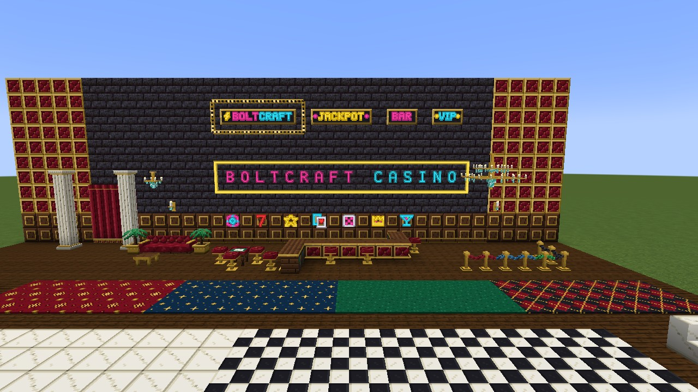

Neon letters and tubes, signs and boards, carpets, tiles, the bar, sofas, chandeliers and more.
